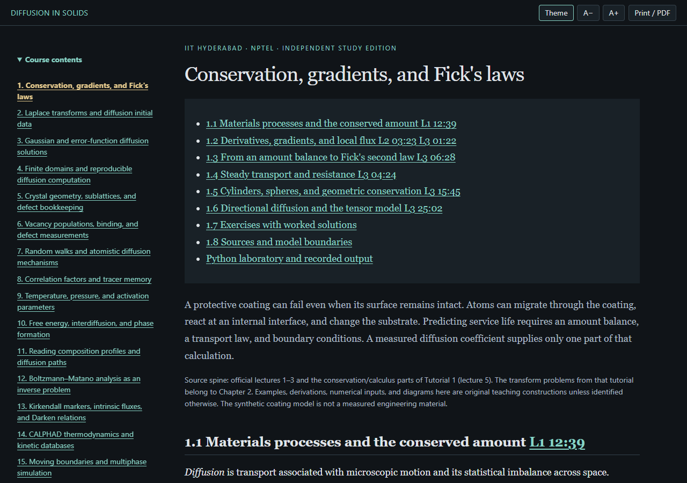

# Diffusion in Solids — an independent study edition

**[Read the complete lecture notes](https://az9713.github.io/nptel-diffusion-in-solids-notes/)**

[](https://az9713.github.io/nptel-diffusion-in-solids-notes/)

Independent notes and mathematical development following **Prof. Mayur Vaidya,
IIT Hyderabad**, [NPTEL 113106635](https://nptel.ac.in/courses/113106635).
The supplied [playlist](https://www.youtube.com/playlist?list=PLyqSpQzTE6M9XsKFqxvlh5_sxnYhwcDKQ)
is hosted by NPTEL-NOC IITM. Its upload order is scrambled; the reader restores
the official teaching sequence.

## What is included

- **28 chapters covering all 60 official lectures**, plus a mapped introduction.
- Approximately **70,249 words**, with explicit assumptions, derivations,
  worked numerical examples, source corrections, and timestamp navigation.
- **168 exercises with complete solutions**, **28 runnable Python laboratories**,
  and **27 original computational figures**.
- A controlled diffusion animation with seeking, playback, reduced-motion
  behavior, and a static print alternative.
- An offline reader with bundled MathJax, dark/light themes, text sizing,
  full-course search, expandable solutions, code copying, and print/PDF output.

[Study guide](https://az9713.github.io/nptel-diffusion-in-solids-notes/study-guide.html) ·
[Source map](https://az9713.github.io/nptel-diffusion-in-solids-notes/source-map.html) ·
[Python laboratory](https://az9713.github.io/nptel-diffusion-in-solids-notes/laboratory.html) ·
[References](https://az9713.github.io/nptel-diffusion-in-solids-notes/references.html) ·
[Evidence and limits](https://az9713.github.io/nptel-diffusion-in-solids-notes/about.html)

The conceptual chain runs from conservation and diffusion equations through
crystal defects and random walks, chemical potentials and interdiffusion,
measurement and inverse problems, and material-specific transport. The final
chapter constructs distinct microscopic models with the same concentration
profile, then asks which additional measurement can separate them.

## Read the chapters online

| Chapter | Topic |
|---|---|
| 1 | [Conservation, gradients, and Fick's laws](https://az9713.github.io/nptel-diffusion-in-solids-notes/chapter-01.html) |
| 2 | [Laplace transforms and diffusion initial data](https://az9713.github.io/nptel-diffusion-in-solids-notes/chapter-02.html) |
| 3 | [Gaussian and error-function diffusion solutions](https://az9713.github.io/nptel-diffusion-in-solids-notes/chapter-03.html) |
| 4 | [Finite domains and reproducible diffusion computation](https://az9713.github.io/nptel-diffusion-in-solids-notes/chapter-04.html) |
| 5 | [Crystal geometry, sublattices, and defect bookkeeping](https://az9713.github.io/nptel-diffusion-in-solids-notes/chapter-05.html) |
| 6 | [Vacancy populations, binding, and defect measurements](https://az9713.github.io/nptel-diffusion-in-solids-notes/chapter-06.html) |
| 7 | [Random walks and atomistic diffusion mechanisms](https://az9713.github.io/nptel-diffusion-in-solids-notes/chapter-07.html) |
| 8 | [Correlation factors and tracer memory](https://az9713.github.io/nptel-diffusion-in-solids-notes/chapter-08.html) |
| 9 | [Temperature, pressure, and activation parameters](https://az9713.github.io/nptel-diffusion-in-solids-notes/chapter-09.html) |
| 10 | [Free energy, interdiffusion, and phase formation](https://az9713.github.io/nptel-diffusion-in-solids-notes/chapter-10.html) |
| 11 | [Reading composition profiles and diffusion paths](https://az9713.github.io/nptel-diffusion-in-solids-notes/chapter-11.html) |
| 12 | [Boltzmann–Matano analysis as an inverse problem](https://az9713.github.io/nptel-diffusion-in-solids-notes/chapter-12.html) |
| 13 | [Kirkendall markers, intrinsic fluxes, and Darken relations](https://az9713.github.io/nptel-diffusion-in-solids-notes/chapter-13.html) |
| 14 | [CALPHAD thermodynamics and kinetic databases](https://az9713.github.io/nptel-diffusion-in-solids-notes/chapter-14.html) |
| 15 | [Moving boundaries and multiphase simulation](https://az9713.github.io/nptel-diffusion-in-solids-notes/chapter-15.html) |
| 16 | [Tracer profiles, SIMS, and electron-probe measurements](https://az9713.github.io/nptel-diffusion-in-solids-notes/chapter-16.html) |
| 17 | [Mechanical relaxation and electrical diffusion probes](https://az9713.github.io/nptel-diffusion-in-solids-notes/chapter-17.html) |
| 18 | [NMR diffusion measurements and local jump times](https://az9713.github.io/nptel-diffusion-in-solids-notes/chapter-18.html) |
| 19 | [Mössbauer and neutron scattering probes](https://az9713.github.io/nptel-diffusion-in-solids-notes/chapter-19.html) |
| 20 | [Grain-boundary diffusion and kinetic regimes](https://az9713.github.io/nptel-diffusion-in-solids-notes/chapter-20.html) |
| 21 | [Dislocation pipe diffusion and pathway competition](https://az9713.github.io/nptel-diffusion-in-solids-notes/chapter-21.html) |
| 22 | [Ordered, nanocrystalline, and quasicrystalline materials](https://az9713.github.io/nptel-diffusion-in-solids-notes/chapter-22.html) |
| 23 | [Diffusion mechanisms in metallic alloys](https://az9713.github.io/nptel-diffusion-in-solids-notes/chapter-23.html) |
| 24 | [High-entropy alloys and the evidence for diffusion claims](https://az9713.github.io/nptel-diffusion-in-solids-notes/chapter-24.html) |
| 25 | [Defect-mediated diffusion in semiconductors](https://az9713.github.io/nptel-diffusion-in-solids-notes/chapter-25.html) |
| 26 | [Diffusion and structural relaxation in metallic glasses](https://az9713.github.io/nptel-diffusion-in-solids-notes/chapter-26.html) |
| 27 | [Ionic solids, defect chemistry, and coupled charge transport](https://az9713.github.io/nptel-diffusion-in-solids-notes/chapter-27.html) |
| 28 | [Synthesis: from a transport question to defensible evidence](https://az9713.github.io/nptel-diffusion-in-solids-notes/chapter-28.html) |

## Read and run locally

Clone the repository or use **Code → Download ZIP**, extract it, and open
`index.html`. Reading assets work offline. Recordings and external papers
require internet access.

```sh
python -m pip install -r requirements-lock.txt
python code_lab.py
python code_lab.py 1
python -X utf8 tools/build_book.py
python -X utf8 tools/check_book.py
python -X utf8 tools/run_labs.py
python -X utf8 tools/check_reader.py
python -X utf8 tools/check_figures.py
python -X utf8 tools/check_controls.py
python -X utf8 tools/check_export.py
python -X utf8 tools/check_book.py --release
```

`code_lab.py` lists the available laboratories; a chapter number runs that lab.
The checked environment uses Python 3.13 with the direct dependency versions in
[requirements-lock.txt](requirements-lock.txt). Browser checks use Playwright
with Google Chrome, or an installed Playwright Chromium browser
(`python -m playwright install chromium`). The export checker builds a clean
public copy, runs all 28 laboratories there, and checks figure reproducibility.

The reader is assembled from directly authored `chapters/chNN.html` fragments.
The builder adds navigation, indices, source/code embeds, and companion pages.
It does not generate scientific exposition. Public rebuilding requires no
private captions, recordings, research downloads, or working review reports.

## Review and verification

Every chapter has **two accepted independent full AI scientific/editorial
reviews** (56 in total), bound to current chapter, code, and scientific-asset
digests, with targeted checks after repairs. Review acceptance, source coverage, laboratory execution,
browser behavior, clean export, and publication have separate records.

- [Completion inventory](completion.json), [edition audit](validation/edition-checks.json),
  and [chapter review records](validation/chapters/).
- [Laboratory checks](validation/laboratory-checks.json),
  [reader checks](validation/reader-checks.json), and
  [figure checks](validation/figure-checks.json).
- [Search, copy, text sizing, and PDF checks](validation/controls-checks.json),
  [source-free rebuild checks](validation/export-checks.json), and
  [release gate](validation/release-checks.json).
- [Production workflow](WORKFLOW.md), [source manifest](source-manifest.json),
  and [detailed outline](plan/outline.md).

The available English caption text was read in full; selected source frames
were inspected to resolve specific equations, tables, and demonstrations.
This is not an exhaustive audiovisual transcription. Mathematical derivations,
finite computational checks, empirical evidence, and AI editorial review have
different scopes; none implies formal proof certification or human expert review.

Synthetic examples are labeled. Reduced Python models complement the course's
software demonstrations; they do not claim execution of licensed DICTRA projects
or proprietary thermodynamic/mobility databases. Source recordings, captions,
slides, downloaded research copies, and private working reviews are excluded.
Local dependency licenses remain in [asset attribution](assets/ATTRIBUTION.md).
